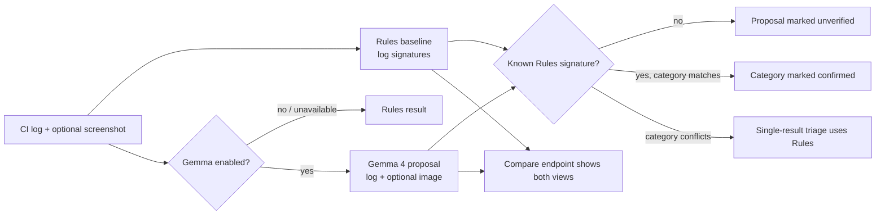

# Actions Nurse

Turn a failed GitHub Actions log and optional screenshot into a diagnosis that developers can inspect: Gemma 4 proposes; deterministic Rules check known failure categories.

[](https://github.com/mangeshraut712/actions-nurse/actions/workflows/ci.yml)


> [!IMPORTANT]
> When Gemma is enabled, the app sends up to 12,000 characters of the CI log and an optional image (up to 5 MiB) to the Gemini API. Use only evidence that is safe to share with that service. Suggested shell commands are displayed for review; Actions Nurse never executes them.

## Demo and prize fit

The web demo pairs a bundled GitHub Actions permission-denied screenshot with a checkout-auth fixture in one click. A local Gemma-enabled run can compare the model proposal with the Rules baseline. The public quick tunnel is **ephemeral and Rules-only**; it does not make a Gemma request.

[Open the temporary demo](https://mini-deleted-wed-week.trycloudflare.com) · [2:30 presenter script](docs/demo-script.md) · [submission copy](docs/MLH-SUBMISSION.md)

| Category | What the project demonstrates | Evidence |
|---|---|---|
| Best Use of Gemma 4 | Text-and-image CI triage through the Gemini API, with a category-level deterministic check and visible input provenance. | [Gemma request and category check](nurse.py), [image comparison UI](web/app.js), [paste-ready entry](docs/MLH-SUBMISSION.md#best-use-of-gemma-4) |
| Best Open-Source AI | MIT-licensed app, key-free Rules path, five sample failures, and a composite Action that writes a Markdown report and workflow summary. | [Action definition](action/action.yml), [failed-run workflow](.github/workflows/actions-nurse.yml), [fixtures](fixtures), [MIT license](LICENSE), [paste-ready entry](docs/MLH-SUBMISSION.md#best-open-source-ai) |

The prize mapping describes the implementation; it does not claim an award or submission outcome.

## How a result is formed



Rules see the log, not the screenshot. The category check compares the reported failure step with a known Rules signature; it does not prove the model’s full root-cause explanation or suggested fix. `/api/compare` keeps the Rules baseline and Gemma proposal side by side.

## Run it

### Key-free local run

Requires Python 3.12 and dependencies from [`requirements.txt`](requirements.txt).

```bash
python3.12 -m venv .venv
. .venv/bin/activate
python -m pip install -r requirements.txt
NURSE_RULES_ONLY=true uvicorn nurse:app --host 127.0.0.1 --port 8787
```

Open [http://127.0.0.1:8787](http://127.0.0.1:8787). The app includes five small log fixtures and a bundled screenshot. The Rules path works without a model key.

### Local Gemma 4 run

Set `GEMINI_API_KEY` (or `GOOGLE_API_KEY`) in the environment or an ignored local `.env` file, then start the app with Rules-only mode disabled:

```bash
GEMINI_API_KEY=your-key NURSE_RULES_ONLY=false uvicorn nurse:app --host 127.0.0.1 --port 8787
```

The default model is `gemma-4-26b-a4b-it`; the code also tries `gemma-4-31b-it` as a fallback when the requested Gemma 4 model returns no usable result. Requests have a 20-second total model budget. Keep the key out of source control and logs.

### Docker Compose

With Docker Compose installed, this single command builds and starts the app, bound to loopback on port 8787:

```bash
NURSE_RULES_ONLY=true docker compose up --build
```

To use Gemma, provide `GEMINI_API_KEY` and set `NURSE_RULES_ONLY=false`. The GitHub CI workflow builds the Compose image and smoke-tests the container. On the workstation used for this documentation pass, `docker compose` was unavailable, so no local image build is claimed. See [current verification](docs/CROSSCHECK.md).

### Smoke check

With the app running at `http://127.0.0.1:8787`, run:

```bash
NURSE_RULES_ONLY=true ./scripts/smoke.sh
```

The script runs the unit tests and exercises Rules-only HTTP health, text triage, screenshot triage, and comparison routes. The server itself must already be running; the script does not start it.

## GitHub Action

The repository’s [`actions-nurse.yml`](.github/workflows/actions-nurse.yml) listens for failed completions of the workflow named `CI`, reads failed job logs, writes a Markdown report and job summary, and uploads the report artifact. When adapting it, set `workflows` to the exact name of your upstream workflow. The workflow grants `actions: read` and `contents: read`.

The snippet uses the same action references as this repository: `actions/checkout@v7`, `mangeshraut712/actions-nurse/action@main`, and `actions/upload-artifact@v7`. The Action reference is the moving `main` branch, not an immutable release pin.

```yaml
name: Actions Nurse on failed CI

on:
  workflow_run:
    workflows: ["CI"] # Replace with the exact upstream workflow name.
    types: [completed]

permissions:
  actions: read
  contents: read

jobs:
  triage:
    if: ${{ github.event.workflow_run.conclusion == 'failure' }}
    runs-on: ubuntu-latest
    steps:
      - uses: actions/checkout@v7
      - name: Diagnose failed workflow
        uses: mangeshraut712/actions-nurse/action@main
        with:
          workflow-run-id: ${{ github.event.workflow_run.id }}
          gemini-api-key: ${{ secrets.GEMINI_API_KEY }} # Optional; omit for Rules-only.
          report-path: nurse-report.md
      - uses: actions/upload-artifact@v7
        with:
          name: actions-nurse-report
          path: nurse-report.md
```

The composite Action can also read a local log with `log-path` and run offline with `rules-only: 'true'`. Inputs and outputs are documented in [`action/action.yml`](action/action.yml). The Action reports a diagnosis; it does not retry, modify, or repair the failed workflow.

## HTTP API

| Method and path | Input | Result |
|---|---|---|
| `GET /api/health` | — | Readiness, Rules-only state, whether a Gemma key is configured and enabled, and the 20-second model budget. This does not probe model service availability. |
| `GET /api/fixtures` | — | Names of the bundled `.txt` log fixtures. |
| `GET /api/fixtures/{name}` | Fixture filename | Fixture name and log text. |
| `POST /api/triage` | JSON: `log`, optional `model`, optional `rules_only` | One validated result; a known category conflict selects Rules. |
| `POST /api/compare` | Same JSON fields | `{ "rules": ..., "gemma": ... }`; Gemma is `null` when skipped or unavailable. |
| `POST /api/triage-image` | Multipart: optional `log`, required `image`, optional `model` and `rules_only` | One result; Rules still classify only the text log. |
| `POST /api/compare-image` | Same multipart fields | Rules baseline plus Gemma proposal using the log and image when enabled. |

`GET /demo-assets/red-actions-permission-failure.png` serves the bundled demo screenshot. Results include the engine, failure step, summary, suggested fix, suggested commands, and validation status where applicable.

## Trust boundary

- **Bounded model input:** Gemma receives at most 12,000 log characters and, if attached, an image no larger than 5 MiB. The end-to-end model budget is 20 seconds.
- **Untrusted evidence:** the prompt treats logs and screenshots as evidence, not instructions, and tells the model not to repeat credentials. Do not send secrets to a hosted model.
- **Limited validation claim:** Rules can confirm a known failure category, reject a category mismatch, or leave an unknown signature unverified. They do not validate arbitrary model prose.
- **No automatic execution:** fix commands are text suggestions only. The UI offers copying; neither the web app nor the Action runs them.
- **Least privilege:** the example failed-run workflow requests read access to Actions and repository contents. Keep any Gemini key in GitHub Secrets.
- **Explicit offline mode:** `NURSE_RULES_ONLY=true` disables model calls. Per-request `rules_only: true` is available on triage and comparison endpoints.

## Verification and project notes

| Check | Evidence |
|---|---|
| Rules and category-validator tests | [7 unit tests](tests/test_validation.py) and [`scripts/smoke.sh`](scripts/smoke.sh) |
| Five Action CLI fixtures | [fixture directory](fixtures) and [CI workflow](.github/workflows/ci.yml) |
| Docker build and container smoke | [latest green CI run on the source baseline](https://github.com/mangeshraut712/actions-nurse/actions/runs/40189125542) |
| Current local and public tunnel status | [verification notes](docs/CROSSCHECK.md) |

For the demo timing, prize copy, and current operational limits, see [`docs/demo-script.md`](docs/demo-script.md), [`docs/MLH-SUBMISSION.md`](docs/MLH-SUBMISSION.md), and [`docs/WIN-PLAN.md`](docs/WIN-PLAN.md).
