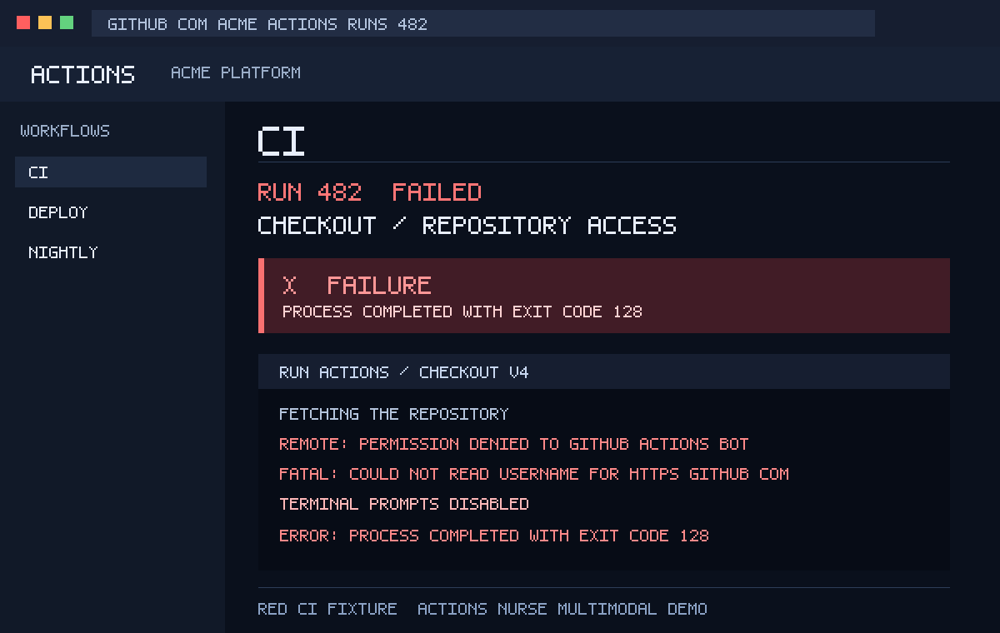

# 🩺 Actions Nurse

**Open-weight Gemma 4 triage for failed GitHub Actions**  
Built for [Hacktoberfest Hack Day Pune x Cloud Native Pune](https://www.mlh.com/events/hacktoberfest-hack-day-pune-x-cloud-native-pune)

> Paste a red CI log (or load the included red screenshot demo) → get failing step, root cause, suggested fix, and copy-paste shell commands.
> Gemma-first: **Gemma 4** gets a hard **12-second** budget. Offline or on failure, deterministic rules keep the diagnosis available.

[](LICENSE)
[](#)
[](action/)

---

## Why judges should care

| Prize | How Actions Nurse fits |
| --- | --- |
| **Best Use of Gemma 4** | Default model `gemma-4-26b-a4b-it` for log + screenshot triage; 12-second bounded response and side-by-side **Rules vs Gemma** evidence view |
| **Best Open-Source AI** | MIT · FastAPI · composite Action · Docker · offline rules · no vendor lock-in |

Cloud-native angle: runs as a **composite GitHub Action** on failed workflows, or as a tiny FastAPI service / Docker container for local demos.

---

## Quick demo (local)

```bash
python3 -m venv .venv && source .venv/bin/activate
pip install -r requirements.txt
# optional: export GEMINI_API_KEY=...   # enables live Gemma 4
uvicorn nurse:app --host 127.0.0.1 --port 8787
# open http://127.0.0.1:8787
```

For the 20-second multimodal moment, click **Load red screenshot demo**. It attaches the bundled failing Actions screenshot and its matching `checkout-auth` log, then click **Triage with Gemma 4**. No key? The result honestly shows the deterministic rules fallback.



Health: `GET /api/health`  
Triage: `POST /api/triage` `{ "log": "..." }`  
Compare: `POST /api/compare` `{ "log": "..." }` → `{ rules, gemma }`  
Multimodal: `POST /api/triage-image` (multipart log + screenshot)

```bash
./scripts/smoke.sh                     # always rules-only and fast
NURSE_PROBE_GEMMA=1 ./scripts/smoke.sh # optional 3-second client-capped probe
```

---

## Use as a GitHub Action

```yaml
# .github/workflows/nurse.yml
name: Actions Nurse
on:
  workflow_run:
    workflows: ["CI"]          # your failing workflow name
    types: [completed]
jobs:
  nurse:
    if: ${{ github.event.workflow_run.conclusion == 'failure' }}
    runs-on: ubuntu-latest
    steps:
      - uses: actions/checkout@v4
      - uses: mangeshraut712/actions-nurse/action@main
        with:
          gemini-api-key: ${{ secrets.GEMINI_API_KEY }}  # optional; rules fallback
          workflow-run-id: ${{ github.event.workflow_run.id }}
          # rules-only: true  # use this for fully offline/reproducible runs
```

Or paste a log file:

```yaml
- uses: mangeshraut712/actions-nurse/action@main
  with:
    log-path: path/to/failed.log
    gemini-api-key: ${{ secrets.GEMINI_API_KEY }}
```

The checked-in [example workflow](.github/workflows/actions-nurse.yml) includes the required `actions: read` permission and uploads the generated markdown report. The Action writes that report and sets `summary` / `engine` outputs for job summaries.

---

## Docker

```bash
docker compose up --build
# http://localhost:8787
```

---

## Architecture

```
failed CI log / screenshot
        │
        ▼
┌───────────────────┐     GEMINI_API_KEY?
│  FastAPI nurse.py │──────────yes────────► Gemma 4 (Gemini API)
│  + web UI         │                      multimodal when image attached
└─────────┬─────────┘
          │ no / error
          ▼
   deterministic regex rules
   (typecheck · pytest · OOM · disk · auth)
```

Composite Action (`action/`) shells out to the same triage logic (`action/nurse_cli.py`) so CI and the web demo stay in sync.

---

## Fixtures

Six reproducible failures live under `fixtures/`: TypeScript typecheck, pytest assertion, Node OOM, npm resolution, disk-full/ENOSPC, and checkout/repository auth. Load them from the UI chips or:

```bash
curl -s localhost:8787/api/fixtures
```

---

## Submission notes (Hack Day Pune)

- **Repo:** https://github.com/mangeshraut712/actions-nurse  
- **License:** MIT  
- **Demo:** local `uvicorn` or Docker; no hosted URL is claimed because an ephemeral tunnel would not be a reliable judge experience
- **Models:** Gemma 4 first; tries only compatible Gemma aliases within 12 seconds, then uses local rules
- Full pitch: [`docs/MLH-SUBMISSION.md`](docs/MLH-SUBMISSION.md) · win checklist: [`docs/WIN-PLAN.md`](docs/WIN-PLAN.md)

---

## License

MIT — built open so anyone can fork the nurse into their own org CI.
